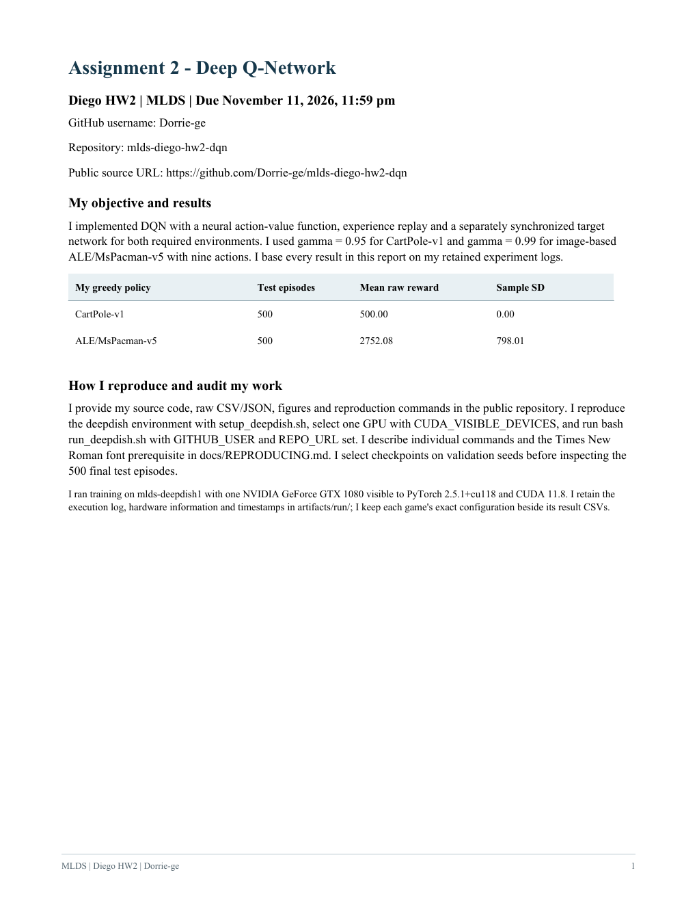
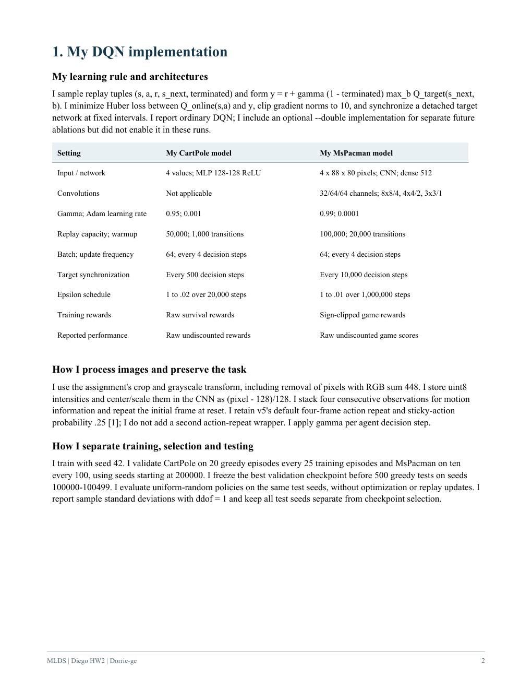
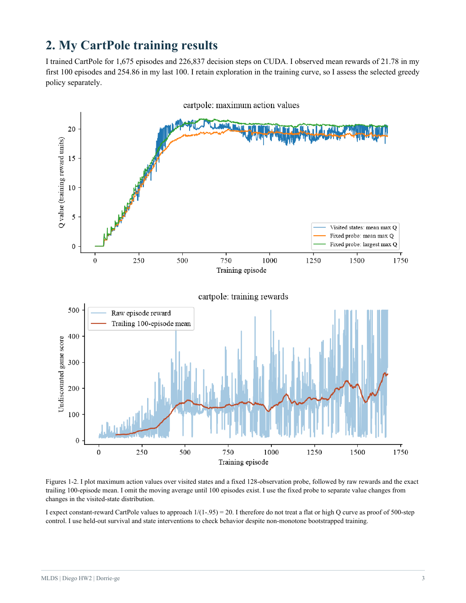
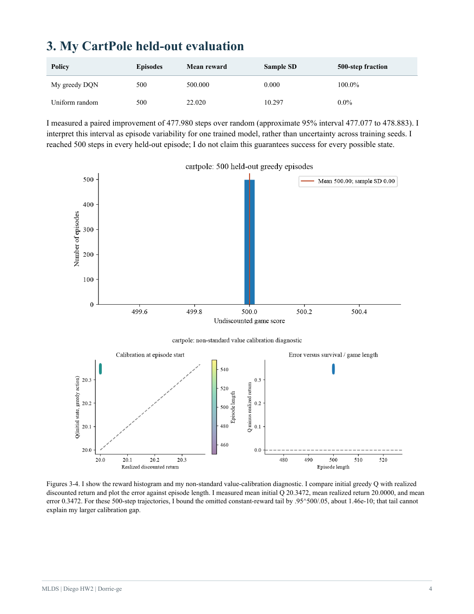
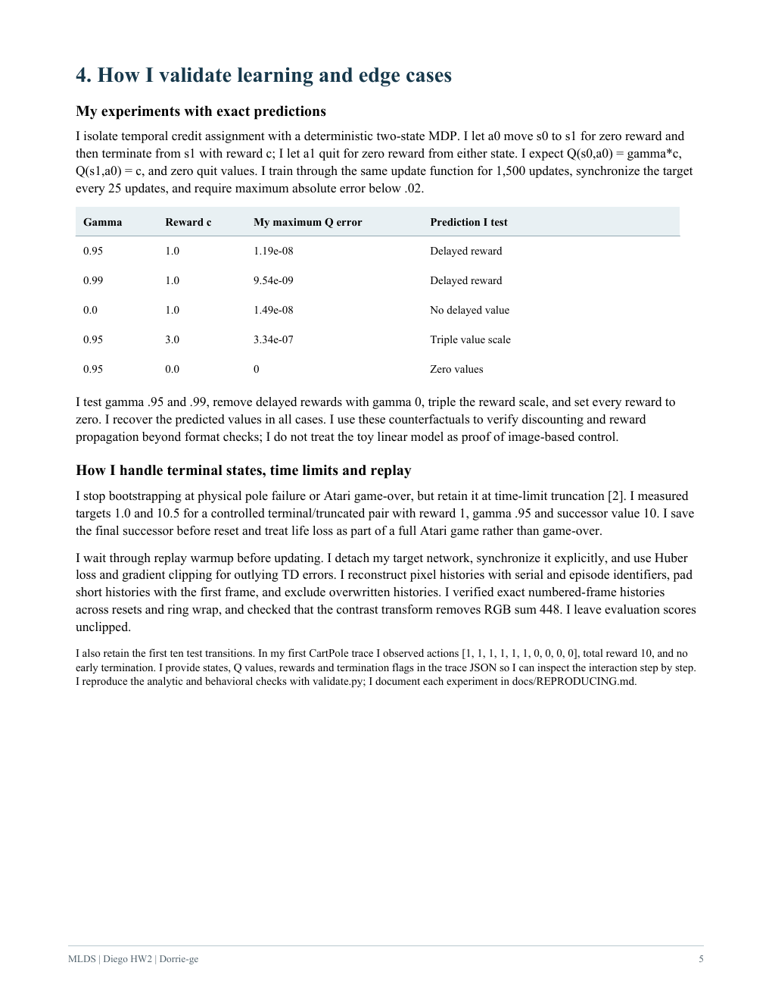
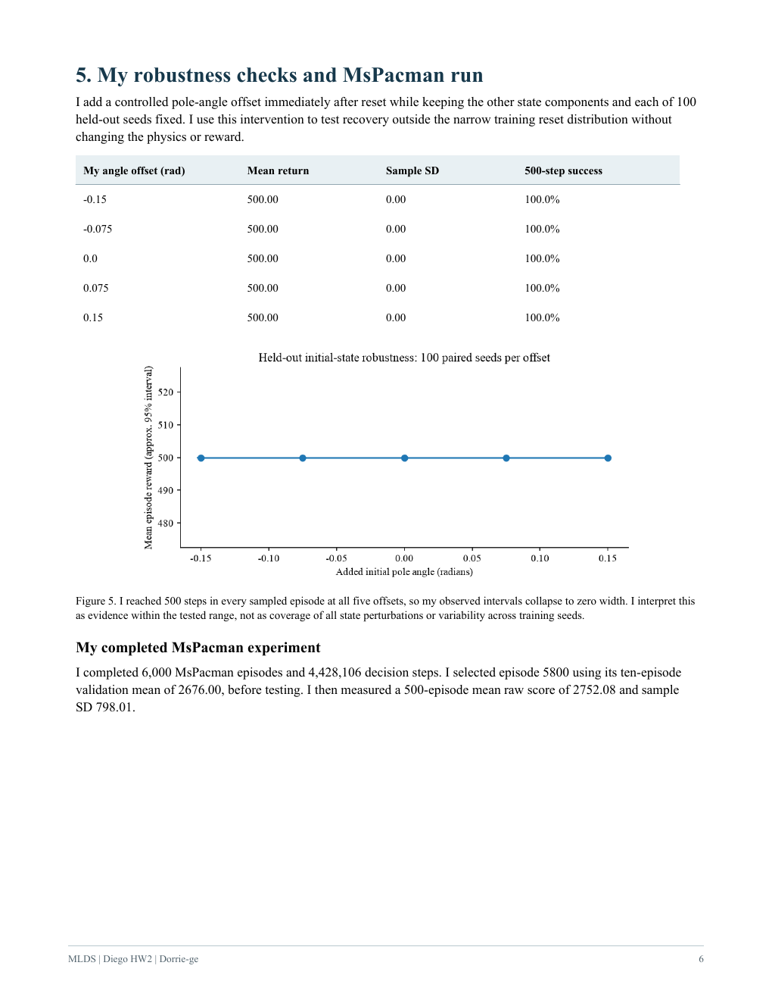
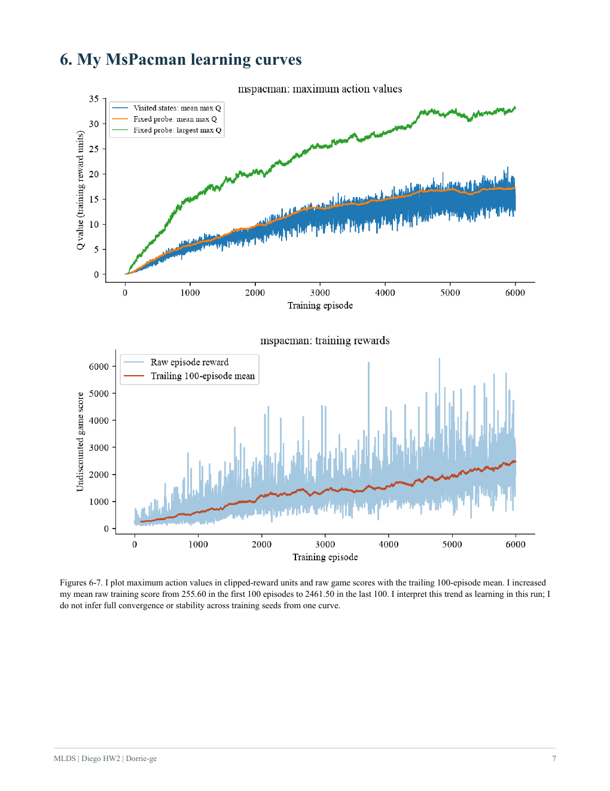
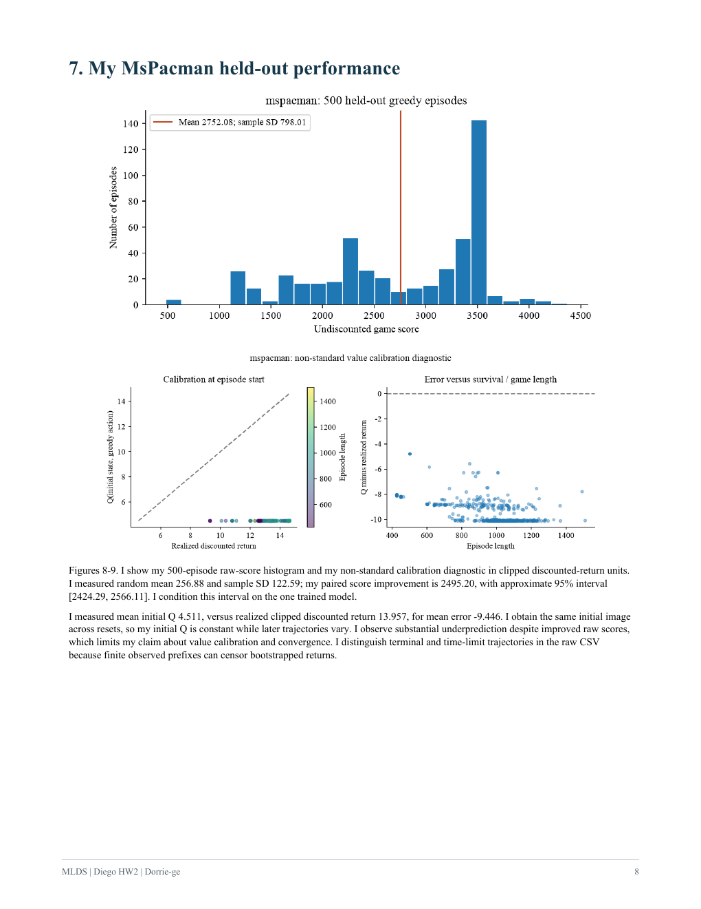
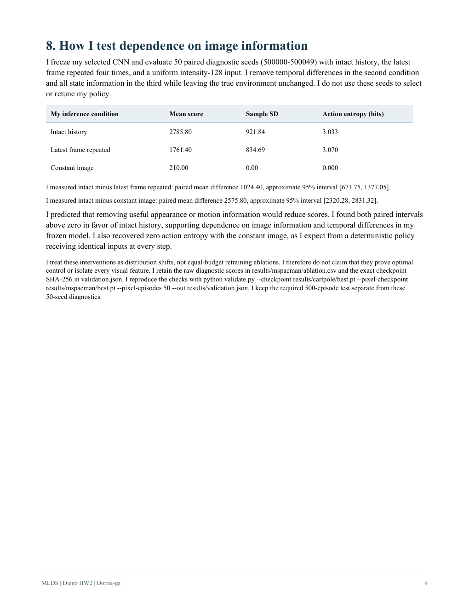
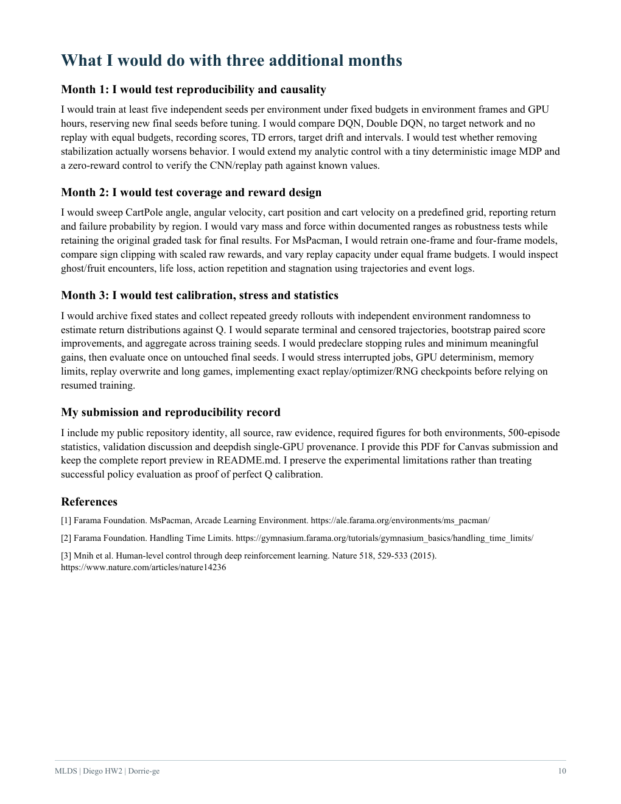

# MLDS Assignment 2 - Deep Q-Network

I implemented and trained DQN for **CartPole-v1** and image-based **ALE/MsPacman-v5** on a single deepdish GPU. I present my complete first-person report below, with the same Times New Roman typography as the PDF.

**[Read or download the final PDF](report.pdf)** · **[Reproduce my experiments](docs/REPRODUCING.md)** · **[Browse raw results](results/)**

## My results

| My greedy policy | Held-out episodes | Mean raw reward | Sample SD |
| --- | ---: | ---: | ---: |
| CartPole-v1 | 500 | 500.00 | 0.00 |
| ALE/MsPacman-v5 | 500 | 2752.08 | 798.01 |

I reached 500 steps in every CartPole test episode. For MsPacman, I completed 6000 training episodes and compared my frozen policy with a matched-seed random baseline (mean 256.88). I also ran analytic learning controls, initial-state robustness checks and paired image-information interventions. I discuss my single-seed and calibration limitations in the report.

## Repository guide

| Location | What I keep there |
| --- | --- |
| [report.pdf](report.pdf) | My complete submission report |
| [dqn.py](dqn.py) | My networks, replay buffer, training and evaluation |
| [validate.py](validate.py) | My analytic, robustness and image-intervention experiments |
| [plots.py](plots.py), [report.py](report.py), [report_fonts.py](report_fonts.py) | Reproducible Times New Roman figures and report |
| [build_readme.py](build_readme.py) | PDF page rendering and this README |
| [results/cartpole/](results/cartpole/), [results/mspacman/](results/mspacman/) | Raw data, configurations, traces and figures |
| [artifacts/run/](artifacts/run/) | My original GPU log, hardware, provenance and completion records |
| [docs/REPRODUCING.md](docs/REPRODUCING.md) | Installation, commands and validation documentation |
| [deployment/nomad/](deployment/nomad/) | My optional Nomad configuration; I used direct SSH for the completed run |

I keep trained checkpoints out of GitHub. I retain their hashes in SHA256SUMS.json and the selected MsPacman checkpoint hash in results/validation.json.

## Regenerate my report

After installing the documented dependencies and licensed Times New Roman fonts, I regenerate the figures, report and embedded pages with:

```bash
python plots.py --results results
python report.py --github-user Dorrie-ge --repo-url https://github.com/Dorrie-ge/mlds-diego-hw2-dqn --final
python build_readme.py
```

I can regenerate the report from the retained results without retraining the networks. I use Poppler's `pdftoppm` to build the page previews. I do not redistribute font binaries; [the font setup instructions](docs/REPRODUCING.md#times-new-roman) explain the supported locations and `TNR_FONT_DIR`.

## My complete report

I embed all 10 pages directly below so the report keeps its Times New Roman font, figures, tables and pagination inside GitHub. Click a page to enlarge it, or use the PDF link above.




















